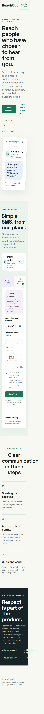
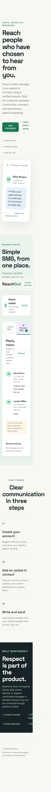

# ReachOut messaging MVP





ReachOut is a small consent-based SMS messaging MVP built with plain HTML, CSS, JavaScript, and Node.js. It provides registration, a local persistent store, verified sender selection, consent checks, a 160-character message limit, demo delivery status, message history, inbox display, and opt-out protection.

## Features

- Account creation and sign-in with locally hashed passwords
- Verified sender selection and international recipient numbers
- Consent confirmation before sending
- Real Twilio SMS mode or safe demo mode
- Delivery status and provider message ID storage
- Incoming SMS webhook and live inbox polling
- STOP/opt-out protection
- Responsive, dependency-light frontend

## Tech stack

- Frontend: semantic HTML, CSS, and browser JavaScript
- Backend: Node.js built-in HTTP server
- Storage: local JSON for development; PostgreSQL recommended for production
- SMS: Twilio Programmable Messaging REST API

## Run locally

```bash
npm start
```

Open <http://localhost:3000>.

The backend stores local data in `data/store.json`. This file is ignored by Git. By default, messages use demo mode. To enable real SMS through Twilio, copy `.env.example` to `.env` (or set the variables in your hosting platform), set `SMS_MODE=twilio`, and provide a Twilio Account SID, Auth Token, and verified Twilio phone number. Never commit `.env` or expose these values in the browser.

For incoming replies, configure your Twilio number's messaging webhook to `https://your-domain.example/api/webhooks/twilio/inbound` using HTTP POST. The inbox polls every ten seconds in the browser, and the webhook persists inbound messages for the matching account.

## Production work

Before public launch, replace the demo token registration with password/OAuth authentication and secure cookies, replace the JSON store with PostgreSQL, add Twilio webhook signature validation, rate limiting, CAPTCHA, abuse monitoring, encrypted secrets, payment/credit handling, HTTPS, backups, privacy/terms pages, and a verified sender/domain. Never use the service to bypass blocks or contact people who opted out.

## GitHub setup

```bash
git init
git add .
git commit -m "Build ReachOut messaging MVP"
git branch -M main
git remote add origin https://github.com/YOUR_USERNAME/YOUR_REPOSITORY.git
git push -u origin main
```

The local `.env` file and runtime database are excluded by `.gitignore`; never commit credentials.
